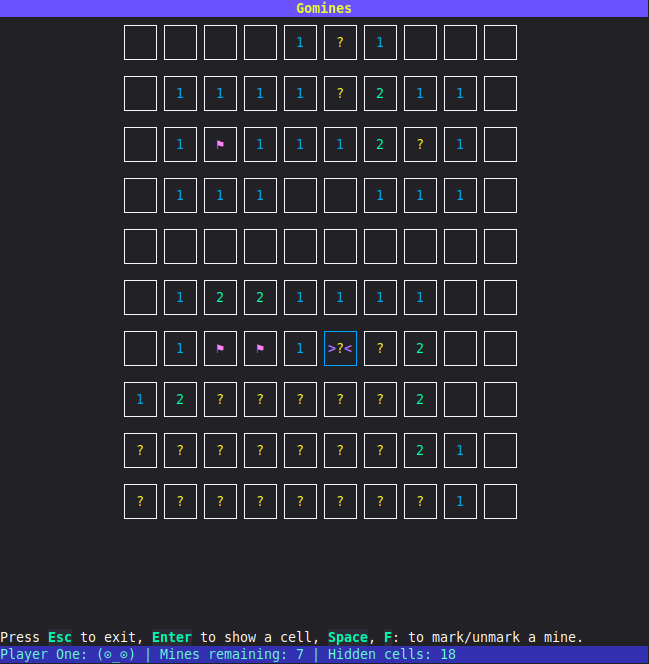

# ✱ Gomines ✱

A little minesweeper game written in Go to play around the [BubbleTea](https://charm.land/libs/) framework.


> [!NOTE]
> The latest version is **{{ .Version }}**.



## 🚀 Quickstart

### From the sources(Go)

Make sure to have **Go 1.24+** and `$GOPATH/bin` in your `PATH`.

Run:

```bash
go install github.com/mconfalonieri/gomines/cmd/gomines@latest
```

## Linux (AppImage)

Download the [latest](https://github.com/mconfalonieri/gomines/releases/latest) AppImage file specific for your architecture (amd64 or arm64).

If you have an AppImage manager, use it. Otherwise, an AppImage is basically a wrapped executable with everything required to run the program, so run:

```bash
mv gomines_{{ .CleanVersion }}_linux_amd64.AppImage gomines

chmod +x gomines
```

Make sure to use the correct architecture suffix: **amd64** or **arm64**.

## 🎮 Guide

### Setup

Once you launch the game, it will ask you some questions. You can just accept
the default value by pressing `Enter` and it is always possible to exit by
pressing `Esc`.

1. Your name (will be visualized later on the status bar). The default is "Player One".
2. The minefield width (default: 10 cells)
3. The minefield height (default: 10 cells)
4. The number of mines (default: 10 cells)
5. The type of glyphs to use: Unicode or ASCII (default: Unicode)

### The game

The goal is to mark all the cells containing mines and to open all hidden cells that don't contain a mine.
The status bar below indicates:

- Player status: an emoticon that represents if the player is still playing, lost, or won;
- Remaining mines: the number of cells that still need to be marked ⚑;
- Hidden cells: the number of hidden cells that don't contain mines.

The following keys can be used to interact while in game mode:

| Key          | Description        |
| ------------ | ------------------ |
| `←`, `H`     | Move left          |
| `↓`, `J`     | Move down          |
| `↑`, `K`     | Move up            |
| `→`, `L`     | Move right         |
| `space`, `F` | Mark/unmark a cell |
| `Enter`      | Reveal a cell      |
| `Esc`        | Exit the game      |

The cells can have the following symbols. Some symbols are available only in specific phases:

 - **any**: the symbol is shown in any phase of the game
 - **game**: the symbol is shown only while the game is going on
 - **end**: the symbol is shown only when the game ends

| Unicode | ASCII | Meaning             | Phase |
| ------- | ----- | ------------------- | ----- |
| `?`     | `?`   | Hidden cell         | game  |
| `⚑`     | `@`   | Marked cell         | any   |
| `✱`     | `*`   | Mine                | end   |
| `✘`     | `X`   | Wrongly marked cell | end   |

When opening an empty cell, the number of mines surrounding this cell will be
shown (or an empty space if it is zero). This number can be used to understand
which cells around it can have a mine.

For example, if the following is shown, we will know that both the cells
marked with `?` are mined, because the number `2` is shown.

```                     
┐┌───┐┌───┐┌───┐
││ 1 ││ ? ││ ? │
┘└───┘└───┘└───┘
┐┌───┐┌───┐┌───┐
││ 1 ││ 2 ││ 2 │
┘└───┘└───┘└───┘
┐┌───┐┌───┐┌───┐
││   ││   ││   │
┘└───┘└───┘└───┘
┐┌───┐┌───┐┌───┐

```

#### End

The game can end in two possible scenarios:

- winning scenario: the player has marked all the mined cells and didn't fall
  on a mine;
- losing scenario: the player fell on a mine. In this case the cells that were
  incorrectly marked are shown as well ✘.
